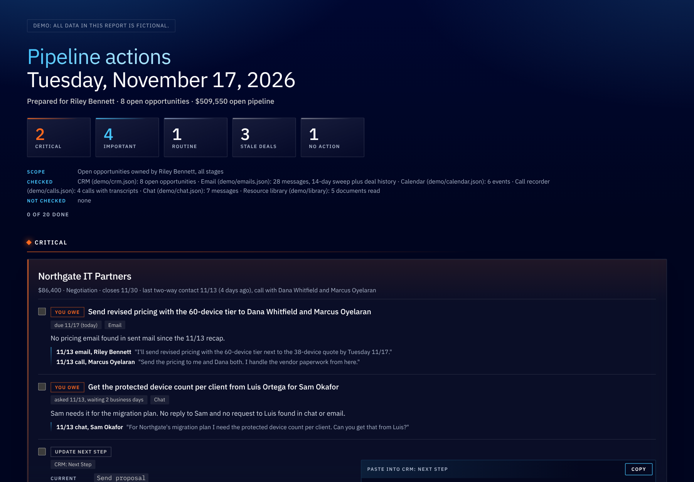

# Pipeline Skill

An AI skill that reviews a seller's open pipeline and hands back one ordered checklist of what needs doing, with the text to paste for each item.

It reads your CRM, email, calendar, call recordings, and chat. It never writes to any of them. You review each suggestion and paste it where it belongs.

I'm an account executive, and I use a version of this on my own pipeline. This repository is a clean rebuild with fictional data so anyone can try it and adapt it.



## What it does

1. **Reads every open opportunity** in the CRM, including contact roles and the Next Step.
2. **Reads what was really said** on each account in your other tools.
3. **Suggests a Next Step entry** for any deal where the CRM no longer matches the evidence, in a consistent format that always ends with the next scheduled call.
4. **Flags CRM gaps,** such as a past-due close date or a missing contact role.
5. **Finds stale deals,** meaning 14 days with no two-way contact, then picks the most relevant resource from your library and drafts a short email built on two things the customer said. If nothing fits, it says so and drafts nothing.
6. **Sweeps your inbox and chat** for anything you promised or were asked for and have not delivered, and anything you asked for that has gone unanswered for 3 business days.

The output is a checklist grouped by urgency and account. Every item shows its evidence, and anything to paste is ready to copy.

## See it first

No setup needed for any of these:

- **[Live sample report](https://1tdtitan.github.io/pipeline-skill/examples/sample-report.html)** opens in your browser, with working checkboxes and copy buttons.
- **[Sample report (markdown)](examples/sample-report.md)** is the same report as plain text.
- **Run the demo yourself:** install the skill and say "run the pipeline skill demo." It runs on bundled fictional data.

The demo follows a partner account manager at a made-up backup vendor that sells through managed service providers. That is one example, and the skill is not tied to any industry. All demo data is invented.

## Why the output can be trusted

A pipeline report is only useful if you can act on it without re-reading every thread. Three design choices are aimed at that.

**Read-only.** The skill is instructed never to change anything in your tools, even when a connector would allow it. The worst outcome of a mistake is a suggestion you ignore.

**Every statement traces to a dated source.** Each item cites its source. A hedged statement ("we could probably sign before month end") is labeled soft and is never written into a Next Step as a commitment. No date appears unless someone stated it. Automatic replies and calendar notices do not count as contact. The full rules are in [`evidence-rules.md`](pipeline-skill/references/evidence-rules.md).

**The report is checked before it is written.** The skill builds the report as data, then runs [`build_report.py`](pipeline-skill/scripts/build_report.py), which refuses to produce a report if, for example:

- a Next Step or email draft mentions a date that the item's own evidence does not show
- an item has no evidence
- a Next Step rests only on soft statements
- an email runs past 120 words or uses filler like "just checking in"
- a stale deal was skipped, or a deal that is not stale was flagged
- a chase is listed before the waiting period has passed

The script also does the date arithmetic (days since contact, business days waited), because that is where language models slip.

## Install

The skill is the [`pipeline-skill/`](pipeline-skill) folder. It follows the Agent Skills format, a folder with a `SKILL.md` file, which Claude and a growing number of other AI tools can load.

| Your tool | What to do |
| --- | --- |
| Claude (desktop or web) | Upload [`dist/pipeline-skill.zip`](dist/pipeline-skill.zip) as a custom skill in your settings. |
| Claude Code | Copy the `pipeline-skill/` folder into `.claude/skills/` in your project, or `~/.claude/skills/` for all projects. |
| Another tool that supports Agent Skills | Copy the `pipeline-skill/` folder into that tool's skills folder. Check its documentation for the location. |
| Anything else (ChatGPT, Gemini, and others) | Paste [`portable/pipeline-skill-prompt.md`](portable/pipeline-skill-prompt.md) into the instructions of a project or custom assistant. This single-file version has every rule but no build script, so the assistant writes the report by hand. |

## First run

Say **"set up the pipeline skill."** A short wizard:

1. Looks at which connectors your AI tool has and maps them to roles: CRM, email, calendar, call recorder, chat, and resource library.
2. Tests each one with a small read and confirms it is signed in as you.
3. Asks which opportunities to review and how your CRM fields are set up.
4. Indexes your resource library so it can match documents to deals.
5. Saves a config so later runs start immediately.

Only a CRM and email are required. If there is no CRM connector, an exported pipeline report works. Every other source is optional, and the report states what it could not see.

After that, ask for **"a pipeline review"** whenever you want one.

## Settings you can change

| Setting | Default |
| --- | --- |
| Report theme | `paper` (light), `graphite` or `midnight` (dark; `midnight` is shown above), or your own colors |
| Stale threshold | 14 days with no two-way contact |
| Sweep window | 14 days |
| Chase threshold | 3 business days |
| Deal history read per account | 90 days |
| Next Step character limit | 255 |
| Critical fields | Amount, Close Date |
| Word for the other side | Customer (or Partner, Client) |

## What's in the repository

```
pipeline-skill/              the skill
  SKILL.md                   main workflow
  references/                detailed rules, read as each step needs them
    setup.md                 setup wizard
    evidence-rules.md        what counts as a fact
    pipeline-review.md       Next Step and CRM checks
    stale-deals.md           stale check, resource fit, email draft
    owes-and-chases.md       the sweep
    report-format.md         urgency, length caps, report data format
    demo.md                  how the demo runs
  scripts/build_report.py    checks the report and renders markdown and HTML
  assets/                    config template, HTML report template
    themes/                  report themes: paper, graphite, midnight, or add your own CSS file
  demo/                      fictional CRM, email, calls, calendar, chat, library
examples/                    the sample report in three formats, plus its data
portable/                    single-file version for tools without skill support
dist/                        zipped skill for upload
tools/
  check_demo.py              verifies the sample report against the demo data
  build_dist.py              regenerates portable/, dist/, and the sample report
```

## Limits

- **Tested on the demo data.** This version has been run against the bundled fictional data, and `tools/check_demo.py` confirms the sample report matches it. It has not been run against live connectors. Expect to adjust setup for your stack.
- **It sees what your tools see.** A phone call nobody logged or a hallway conversation is invisible, which is why absences are worded as "no reply found in email or chat" and not "the customer has not responded."
- **Business days ignore holidays.**
- **It reports. It does not coach.** It won't score deals or suggest tactics.
- **The single-file version has no automatic checks.** Without the build script, the assistant applies the caps and evidence rules on its own.

## License

MIT. See [LICENSE](LICENSE). The `graphite` and `midnight` themes embed the IBM Plex Sans and IBM Plex Mono typefaces, which are licensed under the SIL Open Font License 1.1.
